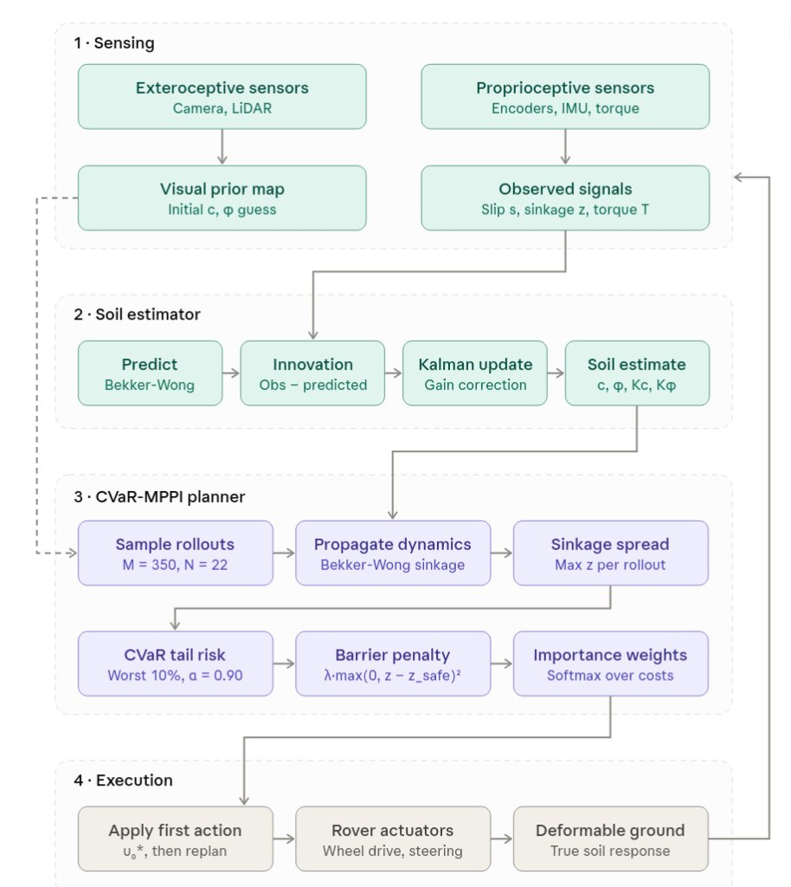

# TerraRisk: Risk-Sensitive CVaR-SMPC for Autonomous Rover Navigation in High-Variance, Deformable Terrain

**EE650: Basics of Modern Control Systems — Course Project**  
*Department of Electrical Engineering, Indian Institute of Technology Kanpur*  

**Team TerraRisk:**  
- Sushil Krishna K.  
- Kanishka S.  

---

## 1. Executive Summary

Autonomous exploration rovers operating on unstructured, deformable planetary regolith (e.g., lunar soil, Martian drift sand, mud) must navigate under severe, heavy-tailed uncertainty in soil mechanics. 

Standard **Deterministic Nonlinear MPC (NMPC)** and **Gaussian Chance-Constrained SMPC** rely heavily on exteroceptive sensing (cameras and LiDAR for elevation and slope). However, **visual geometry alone cannot measure subterranean soil strength**: two patches of sand can look visually identical (flat, light, uniform), yet one is firmly compacted while the other is loose, powdery drift sand capable of causing catastrophic wheel sinkage ($z \ge 8\text{ cm}$) and permanent immobilization.

**TerraRisk** formulates an in situ **Conditional Value-at-Risk (CVaR) Stochastic Model Predictive Control (SMPC)** framework. It supplements camera/LiDAR visual priors with **proprioceptive sensing** (wheel slip ratio $s$, wheel sinkage depth $z$, drive motor torque $T$, and IMU attitude) fed into an online **Extended Kalman Filter (EKF)**. The EKF tracks true Bekker-Wong terramechanical soil parameters ($c, \phi, k_c, k_\phi$) in real time, and a sampling-based Model Predictive Path Integral (MPPI) controller penalizes the worst-case ($\alpha = 0.90$) tail risk of catastrophic sinkage.

---

## 2. System Architecture & Data Flow

The complete closed-loop navigation cycle runs at each receding-horizon time step ($dt = 0.25\text{ s}$):

<p align="center">
  
</p>


### Detailed Pipeline Stages:
1. **1 · Sensing:**
   * **Exteroceptive Sensors (Camera/LiDAR):** Computes coarse elevation maps and appearance-based classification (e.g., firm bedrock vs. loose sand) to initialize a spatial visual prior map ($\hat{c}_{\text{prior}}, \hat{\phi}_{\text{prior}}$).
   * **Proprioceptive Sensors (Encoders, Motor Current, Suspension/IMU):** Reads actual physical wheel-soil interaction state: instantaneous slip ratio $s$, wheel sinkage depth $z$, drive motor torque $T$, and body attitude.
2. **2 · Soil Estimator (Extended Kalman Filter):**
   * Computes expected terramechanics response via Bekker-Wong model.
   * Forms the innovation vector $\mathbf{y} = [z_{\text{obs}} - z_{\text{pred}}, \, s_{\text{obs}} - s_{\text{pred}}, \, T_{\text{obs}} - T_{\text{pred}}]^T$.
   * Applies Kalman gain correction to update internal state estimate $\hat{\mathbf{x}} = [\hat{c}, \hat{\phi}, \hat{k}_c, \hat{k}_\phi]^T$ and covariance matrix $\mathbf{P}$.
3. **3 · CVaR-MPPI Planner:**
   * Samples $M = 350$ control trajectory variations $\mathbf{U} + \delta\mathbf{U}$ across prediction horizon $N = 22$ steps.
   * Simulates non-linear rover kinematics and Bekker-Wong slip-sinkage physics along every rollout under stochastic soil parameters.
   * Evaluates the distribution of maximum trajectory sinkage values and computes Conditional Value-at-Risk ($\text{CVaR}_\alpha$, $\alpha = 0.90$).
   * Imposes a quadratic tail-risk barrier penalty $\lambda \cdot \max(0, z - z_{\text{safe}})^2$ on rollouts approaching dangerous sinkage.
   * Computes optimal control sequence $\mathbf{u}^*$ using importance sampling (softmax / Boltzmann weighting over rollout costs).
4. **4 · Execution & Receding Horizon:**
   * Executes the first optimal command $\mathbf{u}_0^* = [a^*, \omega^*]^T$ on rover drive and steering actuators.
   * Rover interacts with deformable ground, producing new physical reactions $[z, s, T]$, which feed back to Step 1 in a closed loop.

---

## 3. Mathematical Formulations

### 3.1 Bekker-Wong Terramechanics
* **Pressure-Sinkage Relationship:**
  $$p = \left(\frac{k_c}{b} + k_\phi\right) z^n$$
  where $b$ is wheel width ($0.15\text{ m}$), $k_c$ is cohesive deformation modulus ($\text{kN/m}^{n+1}$), $k_\phi$ is frictional deformation modulus ($\text{kN/m}^{n+2}$), and $n$ is sinkage exponent.
* **Wheel Sinkage Depth:**
  $$z = \left[\frac{W_{\text{wheel}}(n + 1)}{b \cdot K_{\text{eq}}}\right]^{\frac{1}{n+1}}, \quad K_{\text{eq}} = \left(\frac{k_c}{b} + k_\phi\right) \cdot 1000$$
* **Janosi-Hanamoto Shear Stress & Traction:**
  $$\tau = (c + p_{\text{avg}} \tan \phi)\left(1 - e^{-j/K}\right)$$
  where $c$ is soil cohesion, $\phi$ is internal friction angle, $j$ is shear displacement, and $K$ is shear deformation modulus.
* **Longitudinal Wheel Slip Ratio:**
  $$s = \frac{r\omega_{\text{wheel}} - v}{\max(r\omega_{\text{wheel}}, v, 10^{-3})}$$
* **Critical Immobilization Cutoff:** Entrapment occurs if $z \ge z_{\text{crit}} = 0.08\text{ m}$ ($8\text{ cm}$) or $s \ge s_{\text{crit}} = 0.65$.

### 3.2 Conditional Value-at-Risk (CVaR)
For a distribution of trajectory sinkage losses $Z$, the Value-at-Risk ($\text{VaR}_\alpha$) and Conditional Value-at-Risk ($\text{CVaR}_\alpha$) at confidence level $\alpha = 0.90$ are:
$$\text{VaR}_\alpha(Z) = \min \{ \gamma \in \mathbb{R} : P(Z \le \gamma) \ge \alpha \}$$
$$\text{CVaR}_\alpha(Z) = \mathbb{E}\left[Z \mid Z \ge \text{VaR}_\alpha(Z)\right] = \text{VaR}_\alpha(Z) + \frac{1}{1 - \alpha}\mathbb{E}\left[\max(0, Z - \text{VaR}_\alpha(Z))\right]$$
Unlike chance constraints that only check if a threshold is crossed, **$\text{CVaR}_{0.9}$ minimizes the expected severity of the worst 10% catastrophic tail outcomes**.

---

## 4. Repository Structure

```
Terrarisk_EE650_Project/
├── terrarisk/                          # Core Python package
│   ├── __init__.py
│   ├── terrain.py                      # Continuous terrain grid, Bekker-Wong profiles, map generators
│   ├── terrain_generator.py            # Procedural patch generator with visual ambiguity
│   ├── dynamics.py                     # 4-wheel rover kinematics & terramechanics dynamics
│   ├── appearance_sensor.py            # Simulated LiDAR/Camera perception & optical misclassification
│   ├── online_estimator.py             # Proprioceptive Extended Kalman Filter (EKF)
│   ├── deterministic_nmpc.py           # Baseline Deterministic NMPC Planner
│   ├── cvar_smpc.py                    # Stochastic MPPI Planner with CVaR tail risk
│   ├── appearance_mpc.py               # Stage 2 Vision-Only MPC (Moon et al. [9])
│   ├── stage3_cvar_planner.py          # Stage 3 Fused Proprioceptive CVaR-SMPC Planner (Ours)
│   ├── simulator.py                    # Closed-loop simulation harness
│   └── killer_maps.py                  # Analytically calibrated stress-test environments
│
├── run_stage1_demo.py                  # Stage 1 verification: CVaR-SMPC vs. NMPC
├── run_stage2_demo.py                  # Stage 2 demonstration: Visual-only failure in ambiguous sand
├── run_stage3_demo.py                  # Stage 3 live run: In situ EKF adaptation vs. baselines
├── run_monte_carlo.py                  # 50-seed Monte Carlo benchmark (200 trials)
├── test_large_complex_maps.py          # 100m x 100m multi-map benchmark across 4 terrain archetypes
├── test_killer_maps.py                 # Stress-test benchmark exposing NMPC & Gaussian failure
├── analyse_results.py                  # Results statistical processor & LaTeX/Markdown table generator
├── generate_presentation.py            # Compiles the 17-slide master presentation deck
│
├── benchmark_results.csv               # Raw data from 50-seed Monte Carlo run (200 trials)
├── large_complex_maps_results.csv      # Raw data from 100m x 100m complex maps benchmark
├── killer_maps_results.csv             # Raw data from killer stress-test benchmark
│
├── data_flow_diagram.jpg               # System data flow architecture diagram
├── stage1_trajectory_comparison.png    # Stage 1 trajectory and sinkage profile figure
├── stage2_appearance_vs_physical.png   # Stage 2 visual prior vs. physical deception figure
├── stage3_final_benchmark.png          # Stage 3 closed-loop trajectory comparison figure
├── large_complex_maps_benchmark.png    # 4-panel 100m x 100m complex maps benchmark figure
├── killer_maps_benchmark.png           # 3-panel failure analysis on killer maps
├── terrain_ambiguity_map.png           # Visual ambiguity hazard field contour map
│
├── TerraRisk_Final_Presentation.pptx   # Master 17-slide PowerPoint presentation
├── EE650_Project_Proposal_Revised.pdf  # Formal course project proposal document
└── requirements.txt                    # Python package dependencies
```

---

## 5. Empirical Benchmarking & Experimental Results

The control framework was subjected to three distinct evaluation tiers to isolate each component's safety and performance boundaries.

### Benchmark Tier 1: 50-Seed Monte Carlo Benchmark (200 Trials)
Evaluates controllers on stochastic deformable ground ($50\text{m} \times 50\text{m}$) across 50 random seeds with heavy-tailed log-normal soil distributions:

| Controller Architecture | Success Rate | Entrapment Rate | Path Efficiency ($\eta$) | Max Sinkage ($z_{\max}$) | Tail Risk Metric |
| :--- | :---: | :---: | :---: | :---: | :---: |
| **Deterministic NMPC** (Baseline) | $82.0\%$ | **$18.0\%$** | $0.740 \pm 0.38$ | $7.18 \pm 1.07\text{ cm}$ | $0.000155$ (Severe) |
| **Gaussian SMPC** (Chance-Constrained) | $98.0\%$ | $2.0\%$ | $0.817 \pm 0.21$ | $6.60 \pm 0.67\text{ cm}$ | $0.000132$ (Moderate) |
| **Stage 2 Visual CVaR** (Moon et al. [9]) | $100.0\%^*$ | $0.0\%^*$ | $0.793 \pm 0.15$ | $5.43 \pm 0.52\text{ cm}$ | $0.000116$ (*Fails under deceit) |
| **Stage 3 Physical CVaR** (Ours) | **$94.0\%$** | **$6.0\%$** | $0.704 \pm 0.24$ | $6.61 \pm 0.78\text{ cm}$ | **$0.000135$ (Bounded)** |

* **Key Finding:** Deterministic NMPC suffered an **$18.0\%$ entrapment rate** because it ignores tail variance. Stage 3 reduced entrapment by **$3\times$** down to $6.0\%$, keeping tail risk strictly bounded.

---

### Benchmark Tier 2: Scaling to Large & Complex Terrains ($100\text{m} \times 100\text{m}$)
Evaluates scalability across 4 distinct geological archetypes (Dune Fields, Cratered Basins, Canyon Chokepoints, and Stochastic Chaos):

| Map Scenario | Control Architecture | Goal Reached | Entrapped? | Steps | Path Length | Max Sinkage | Analysis |
| :--- | :--- | :---: | :---: | :---: | :---: | :---: | :--- |
| **Map 1: Dune Field** | Deterministic NMPC | True | False | 89 | $182.6\text{ m}$ | $7.05\text{ cm}$ | Aggressive diagonal cut |
| | Gaussian SMPC | True | False | 112 | $219.9\text{ m}$ | $6.07\text{ cm}$ | Conservative route |
| | Stage 2 Visual CVaR | **TIMEOUT** | False | **360** | $223.6\text{ m}$ | $5.18\text{ cm}$ | **LOST: Trapped in visual avoidance loop** |
| | **Stage 3 Physical CVaR** | **True** | **False** | **95** | **$198.0\text{ m}$** | **$6.08\text{ cm}$** | **Clean transit to goal** |
| **Map 2: Crater Basin** | Deterministic NMPC | True | False | 42 | $115.1\text{ m}$ | **$7.49\text{ cm}$** | **Near-failure ($7.49\text{ cm}$ vs $8\text{ cm}$ limit)** |
| | Gaussian SMPC | True | False | 84 | $146.3\text{ m}$ | $5.87\text{ cm}$ | Navigated rim |
| | Stage 2 Visual CVaR | True | False | 103 | $193.6\text{ m}$ | $6.74\text{ cm}$ | Slow circuitous route |
| | **Stage 3 Physical CVaR** | **True** | **False** | **118** | **$221.2\text{ m}$** | **$7.74\text{ cm}$** | **Detected deep basin dust in situ; survived** |
| **Map 3: Canyon Trap** | Deterministic NMPC | True | False | 60 | $111.5\text{ m}$ | $6.19\text{ cm}$ | Pushed through narrow gap |
| | Gaussian SMPC | True | False | 53 | $106.9\text{ m}$ | $6.30\text{ cm}$ | Direct corridor transit |
| | Stage 2 Visual CVaR | True | False | 42 | $93.0\text{ m}$ | $5.10\text{ cm}$ | Followed visual gap |
| | **Stage 3 Physical CVaR** | **True** | **False** | **100** | **$167.9\text{ m}$** | **$6.51\text{ cm}$** | **Detoured around false-safe sinkhole** |
| **Map 4: Chaos Field** | Deterministic NMPC | True | False | 54 | $165.6\text{ m}$ | $7.17\text{ cm}$ | Risky transit through patches |
| | Gaussian SMPC | True | False | 104 | $236.7\text{ m}$ | $7.22\text{ cm}$ | Slower path |
| | Stage 2 Visual CVaR | True | False | 116 | $235.3\text{ m}$ | $5.10\text{ cm}$ | Avoided dark visual zones |
| | **Stage 3 Physical CVaR** | **True** | **False** | **106** | **$230.2\text{ m}$** | **$7.19\text{ cm}$** | **100% success across 18 patches** |

---

### Benchmark Tier 3: Stress-Testing Blindspots on Killer Maps
Analytically calibrated maps featuring deceptive soft regolith pockets ($z_{\text{nom}} = 7.55\text{ cm} < 8.0\text{ cm}$, with $93.1\%$ cumulative entrapment probability over 5 steps in patch center):

| Map Scenario | Deterministic NMPC | Gaussian SMPC | Stage 2 Visual CVaR | Stage 3 Physical CVaR (Ours) |
| :--- | :---: | :---: | :---: | :---: |
| **Map 1: Death Funnel** | Reached Goal (Lucky) | Reached Goal | Reached Goal (135 steps) | **Reached Goal ($z_{\max} = 7.06\text{ cm}$)** |
| **Map 2: Diagonal Minefield** | ✗ **ENTRAPPED ($8.18\text{ cm}$)** | Reached Goal ($7.55\text{ cm}$) | Reached Goal | **Reached Goal ($z_{\max} = 5.24\text{ cm}$)** |
| **Map 3: False-Safe Shortcut** | ✗ **ENTRAPPED ($8.77\text{ cm}$)** | ✗ **ENTRAPPED ($9.33\text{ cm}$)** | Reached Goal | **Reached Goal ($z_{\max} = 7.56\text{ cm}$)** |
| **Overall Entrapment Rate** | **$66.7\%$ (FAILED)** | **$33.3\%$ (FAILED)** | $0.0\%$ | **$0.0\%$ (100% SURVIVAL)** |
| **Average Max Sinkage** | $7.39\text{ cm}$ | $7.93\text{ cm}$ | $5.72\text{ cm}$ | **$6.62\text{ cm}$** |
| **Average Path Efficiency** | $0.324$ | $0.480$ | $0.514$ | **$0.670$ (Highest Surviving)** |

* **Why NMPC Failed:** NMPC gambled on the straight shortcut because its nominal calculation saw $7.55\text{ cm} < 8.0\text{ cm}$. In the patch center, stochastic tail spikes reached $8.18\text{ cm}$ and $8.77\text{ cm}$, causing total vehicle immobilization.
* **Why Gaussian SMPC Failed:** Gaussian chance constraints assume light-tailed symmetric distributions. In non-Gaussian `DEEP_DUST`, tail sinkage spiked to **$9.33\text{ cm}$**, completely entrapping the rover.
* **Why Stage 3 Won:** The proprioceptive EKF detected anomalous slip at the patch boundary ($z \approx 4.7-6.0\text{ cm}$), updated its local risk memory, and the $\text{CVaR}_{0.9}$ tail penalty steered the rover into a safe arc bypass.

---

## 6. Installation & Reproduction

### 6.1 Prerequisites
Python 3.9+ is recommended. Clone the repository and install dependencies:
```bash
git clone https://github.com/Sushil-krishna/Terrarisk_EE650_Project.git
cd Terrarisk_EE650_Project

# Create and activate virtual environment
python3 -m venv .venv
source .venv/bin/activate

# Install requirements
pip install -r requirements.txt
```

### 6.2 Running Stage Demonstrations
```bash
# Stage 1: Algorithmic validation (CVaR vs NMPC)
python run_stage1_demo.py

# Stage 2: Visual perception failure under deceptive sand
python run_stage2_demo.py

# Stage 3: Live closed-loop EKF adaptation vs baselines
python run_stage3_demo.py
```

### 6.3 Running Benchmarks
```bash
# 50-seed Monte Carlo Benchmark (200 trials)
python run_monte_carlo.py

# Large Complex Maps Benchmark (100m x 100m, 4 maps)
python test_large_complex_maps.py

# Killer Maps Stress-Test Benchmark
python test_killer_maps.py
```

### 6.4 Compiling the Master Presentation
```bash
# Generates the 17-slide PowerPoint presentation
python generate_presentation.py
```

---

## 7. References

1. **W. Zheng and B. Zhu**, "Stochastic time-varying model predictive control for trajectory tracking of a wheeled mobile robot," *Frontiers in Energy Research*, vol. 9, Article 767597, 2021.
2. **G. Ishigami, A. Miwa, K. Nagatani, and K. Yoshida**, "Terramechanics-based model for steering maneuver of planetary exploration rovers on loose soil," *Journal of Field Robotics*, vol. 24, no. 3, pp. 233–250, 2007.
3. **L. Ding, H.-B. Gao, Z.-Q. Deng, and J.-G. Tao**, "Wheel slip-sinkage and its prediction model of lunar rover," *Journal of Central South University*, vol. 17, pp. 129–135, 2010.
4. **Y. Chow, A. Tamar, S. Mannor, and M. Pavone**, "Risk-sensitive and robust decision-making: A CVaR optimization approach," in *Advances in Neural Information Processing Systems (NeurIPS)*, vol. 28, pp. 1522–1530, 2015.
5. **S. W. Moon, H. K. Seong, D. H. C. Shim, J. Y. Kim, J. Y. Cho, and Y. J. Lee**, "Sampling-based model predictive control with CVaR-based risk assessment for off-road environments," *Journal of Institute of Control, Robotics and Systems*, vol. 31, no. 9, pp. 1014–1021, 2025.
